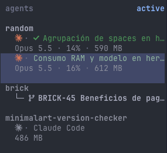

# herdr-agent-ram-consumption

A herdr plugin that shows, for every agent in the Agents sidebar, its model, how
full its context window is, and how much RAM its pane uses:

```
Opus 5.5 · 17% · 1.2 GB
```

The context figure turns amber at 75% and red at 90%.



## Install

Install the plugin from GitHub with herdr's plugin installer:

```
herdr plugin install jmarcosg/herdr-agent-ram-consumption
```

The plugin builds itself (`go build`, so Go is required) and starts a background
daemon with herdr. The `Agent stats: restart daemon` and `Agent stats: stop and
clear` actions control it.

## Sidebar row

The daemon publishes pane tokens; the row that displays them comes from
[herdr-radar](https://github.com/jmarcosg/herdr-radar). Add this to radar's plugin
`config.toml`:

```toml
[extra_row]
agent_model = "#8b8e9c"
agent_ctx_ok = "#8b8e9c"
agent_ctx_warn = "#c78a1f"
agent_ctx_crit = "#c04a4a"
agent_mem = "#8b8e9c"
```

This needs a radar with the `extra_row` feature. Until it is merged upstream, use
the fork `jmarcosg/herdr-radar`.

## Supported agents

Claude Code, Codex, OpenCode and Gemini CLI get model, context % and RAM. Any other
agent gets RAM only.

## Credits

The detection algorithms are ported from
[Cornercase](https://github.com/usecornercase/cornercase-terminal) (Apache-2.0).
See [NOTICE](NOTICE).
